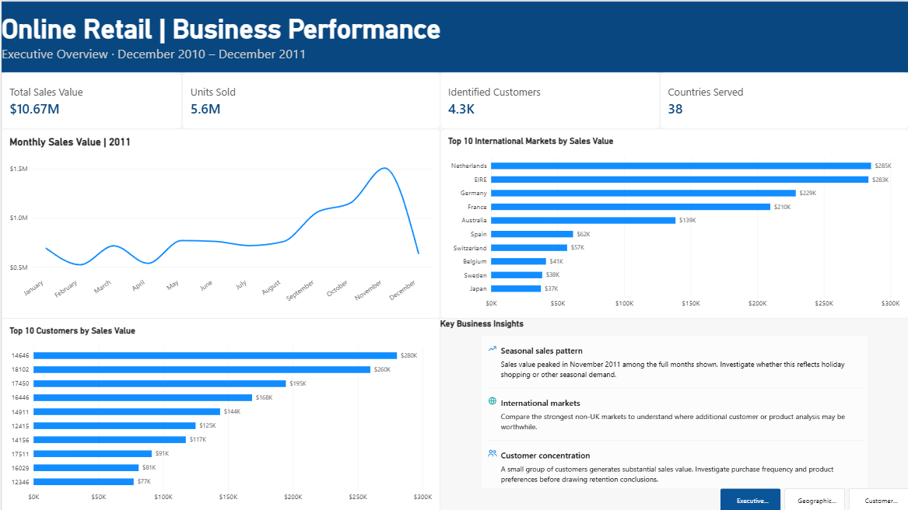

# Online Retail Sales & Customer Segmentation
A Power BI analytics project exploring historical retail sales performance, international markets, and customer purchasing behavior through RFM segmentation.

## Project Overview

This project analyzes online retail transactions to identify sales trends, compare international markets, examine high-value customers, and segment customers based on recency, frequency, and monetary value.

The final deliverable is a three-page interactive Power BI dashboard designed to translate transaction data into business insights.

## Business Questions

- How does sales value vary over time?
- Which international markets contribute the most sales value and unit demand?
- Which customers generate the highest sales value?
- How can RFM analysis help prioritize customer retention and re-engagement?

## Tools & Skills
- Power BI: Interactive dashboards and data visualization
- Power Query: Data cleaning and transformation
- DAX: Sales-value calculations, customer metrics, and RFM scoring
- Customer analytics: Segmentation and purchasing behavior analysis

## Dashboard Pages

1. Executive Overview

Monthly sales trends, leading markets, and high-value customers.

2. Geographic Analysis

Country-level comparisons of sales value and unit demand.

3. Customer Segmentation & RFM Analysis

Customer-level recency, purchase frequency, monetary value, and rule-based segments.

## Dashboard Preview

### Executive Overview

## Data Preparation

The original dataset contains more than 540,000 transaction records. Data preparation included filtering nonpositive quantities and negative unit prices for the primary sales analysis, calculating transaction-line sales value, and excluding transactions without an identified customer from customer-level RFM analysis.

## Analytical Approach

RFM scoring uses three dimensions:
- Recency: Days since the customer's last observed purchase
- Frequency: Number of distinct invoices
- Monetary Value: Total transaction-line sales value
Each dimension is scored on a relative 1–5 scale. Customers are grouped into segments using explicit scoring rules.

## Limitations

The dataset covers December 2010 through December 2011, with December 2011 only partially observed. It does not include product costs, profit margins, marketing spend, or campaign attribution. Excluding negative-quantity transactions means the primary sales analysis does not represent a complete returns-adjusted accounting measure. Missing customer IDs also limit customer-level analysis.

RFM segments are rule-based analytical groupings and have not been validated as predictive models.

## Repository Contents
- powerbi/: Power BI report file
- screenshots/: Dashboard screenshots
- README.md: Project documentation

## Business Applications

Potential applications include sales monitoring, identifying important international markets for further investigation, prioritizing high-value customer retention, and exploring customer re-engagement opportunities.
